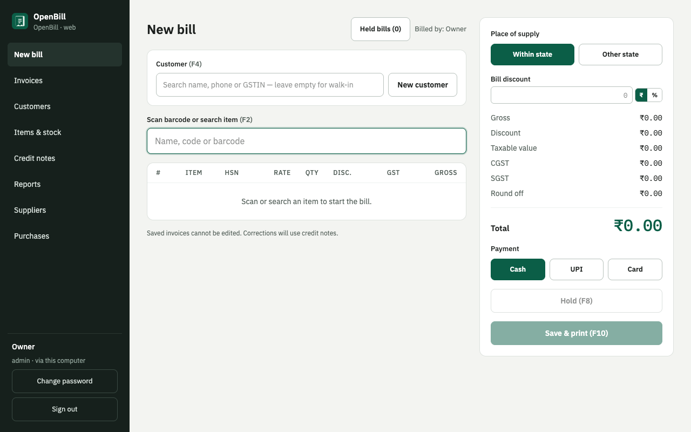
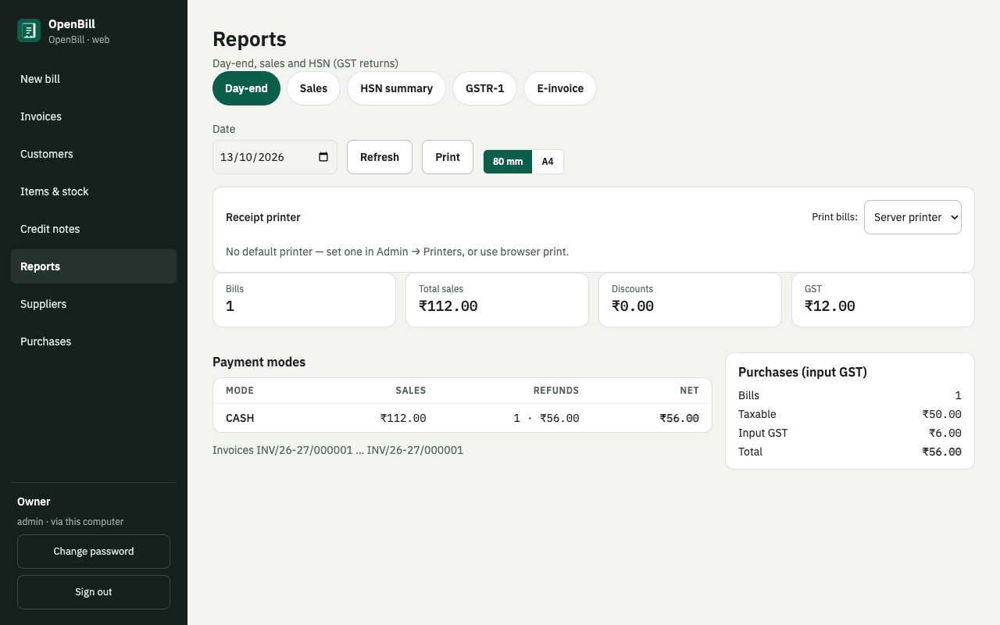
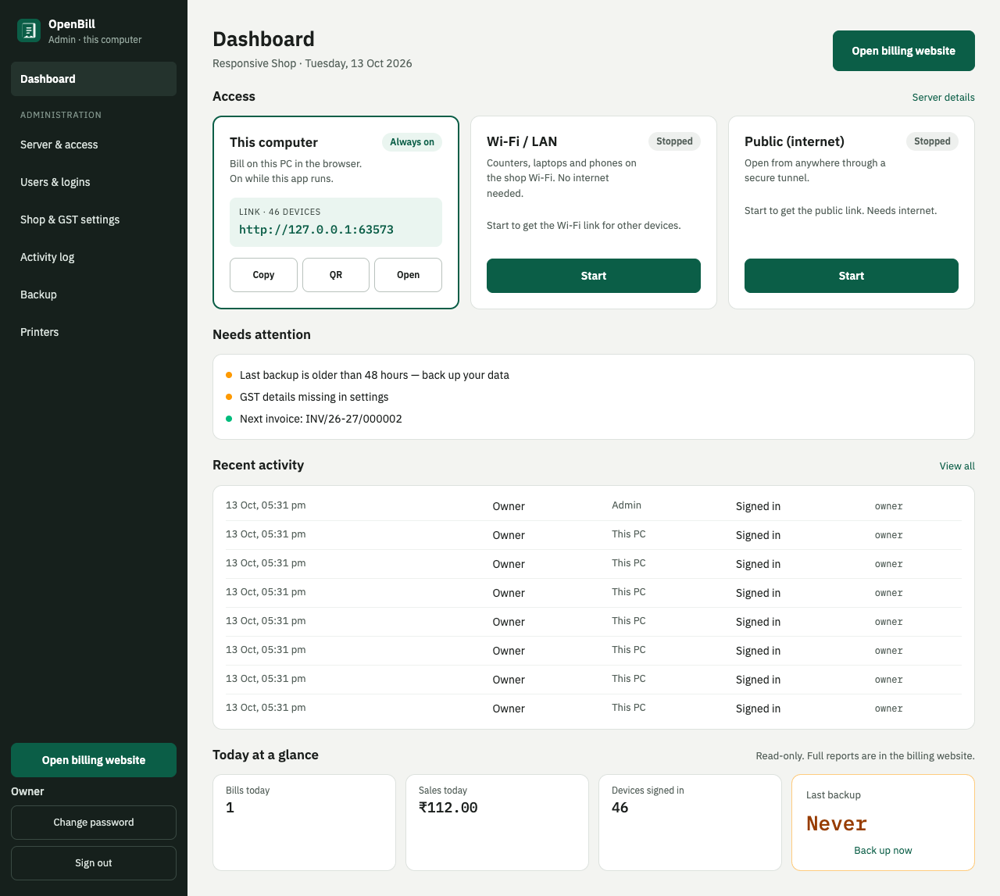
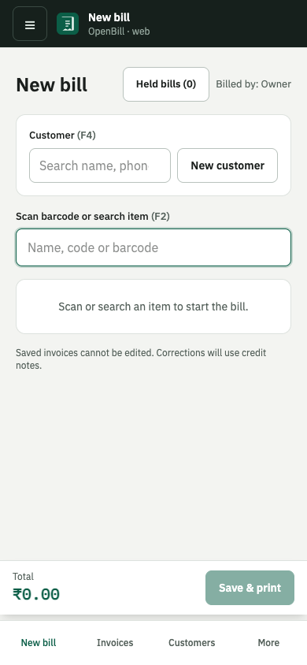

# OpenBill

**Free, open-source, offline GST billing for Indian shops.**

[](https://github.com/vpjigin/OpenBill/releases/latest)
[](LICENSE)
[](https://github.com/vpjigin/OpenBill/actions/workflows/ci.yml)

## Download

Install the desktop app on your shop computer (Windows, macOS, or Linux). It runs the server; counters and phones bill in the browser.

| Platform | Download |
|----------|----------|
| macOS Apple Silicon (M1–M4) | [OpenBill-macOS-AppleSilicon.dmg](https://github.com/vpjigin/OpenBill/releases/latest/download/OpenBill-macOS-AppleSilicon.dmg) |
| macOS Intel | [OpenBill-macOS-Intel.dmg](https://github.com/vpjigin/OpenBill/releases/latest/download/OpenBill-macOS-Intel.dmg) |
| Windows (recommended) | [OpenBill-Windows-Setup.exe](https://github.com/vpjigin/OpenBill/releases/latest/download/OpenBill-Windows-Setup.exe) |
| Windows (alternative) | [OpenBill-Windows.msi](https://github.com/vpjigin/OpenBill/releases/latest/download/OpenBill-Windows.msi) |
| Linux AppImage | [OpenBill-Linux.AppImage](https://github.com/vpjigin/OpenBill/releases/latest/download/OpenBill-Linux.AppImage) |
| Linux Debian/Ubuntu | [OpenBill-Linux.deb](https://github.com/vpjigin/OpenBill/releases/latest/download/OpenBill-Linux.deb) |
| Linux Fedora/RHEL | [OpenBill-Linux.rpm](https://github.com/vpjigin/OpenBill/releases/latest/download/OpenBill-Linux.rpm) |

[All versions → Releases](https://github.com/vpjigin/OpenBill/releases)

### Install notes

**macOS** — OpenBill is not signed with an Apple Developer certificate, so macOS may block it (“can’t be opened” / “is damaged”). After dragging **OpenBill** to **Applications**, run once in Terminal:

```bash
xattr -dr com.apple.quarantine /Applications/OpenBill.app
```

Alternative: **System Settings → Privacy & Security → Open Anyway**. You only need to do this once.

**Windows** — SmartScreen may show “Windows protected your PC” because the installer is not code-signed. Click **More info → Run anyway**. Once only.

**Linux**

- **.deb:** `sudo apt install ./OpenBill-Linux.deb`
- **.AppImage:** `chmod +x OpenBill-Linux.AppImage` then run it. On Ubuntu 22.04+ you may need `libfuse2`; on 24.04 try `libfuse2t64`. No security prompt.

## What is OpenBill?

OpenBill is billing software for Indian retail and small wholesale: GST invoices, stock, purchases, and reports — **without needing the internet** for day-to-day billing. All data stays in one SQLite database on your shop PC.

<p align="center">
  
  
  
</p>
<p align="center">
  
</p>

**How it works:** you install the **desktop admin app** on the shop computer. It starts a local server and opens the admin console. **Billing happens in a browser** — on that same computer, on phones and laptops over shop Wi‑Fi, or from anywhere via an optional public link you control.

```
 ┌──────────────── Shop computer (desktop app) ─────────────────┐
 │  Tauri window ──► 127.0.0.1:9090  Admin app  (admin only)     │
 │                                                                │
 │  Spring Boot server ─── SQLite file (billing.db)               │
 │     ├─ 127.0.0.1:8080       Billing website · this computer   │  always on
 │     ├─ <LAN IP>:8080        Billing website · Wi-Fi / LAN     │  Start / Stop
 │     └─ 127.0.0.1:8081 ◄── cloudflared ◄── Public link         │  Start / Stop
 └────────────────────────────────────────────────────────────────┘
        ▲ counters, laptops, phones on the Wi-Fi      ▲ owner from anywhere
```

## Features

**GST billing**

- Tax-inclusive or exclusive rates, CGST/SGST/IGST, inter-state
- Line discounts, bill discount, round-off
- Decimal quantities where needed
- Walk-in and saved customers (GSTIN, state, address)
- Credit notes (returns/refunds) against invoices
- Hold bill and resume later
- Invoice numbering and printable A4 / 80 mm receipts

**Stock & purchases**

- Items with HSN, GST %, stock, cost and margin
- Low-stock alerts
- Suppliers and purchase bills (input GST, stock in)
- Barcode labels (A4 sheets and roll layouts)

**People & security**

- Users with roles: Cashier, Manager, Admin
- Web sign-in for Wi‑Fi / public access (optional per user)
- Activity log (who did what, from where)
- Login rate limiting

**Reports & compliance helpers**

- Day-end, sales by date, HSN summary
- GSTR-1 export (zip for offline tool)
- E-invoice JSON export and validation hints for B2B
- Backup, restore, and scheduled local backups

**Access & hardware**

- Wi‑Fi billing URL and QR from admin
- Optional Cloudflare quick tunnel or named public link
- Thermal receipt printing (USB/OS printer or network RAW)
- Responsive billing UI for phones and tablets

## Quick start (shop owners)

1. **Install** OpenBill on the shop computer (see [Download](#download)).
2. **First launch:** complete setup (shop name, GSTIN, state, admin user).
3. **Open the billing website:** Admin → Dashboard → **Open billing website**, and sign in with the admin user.
4. **Add items:** billing website → **Items & stock** (rate, GST %, HSN, opening stock).
5. **Make the first bill:** billing website → **New bill**, then save and print.
6. **Add staff:** Admin → **Users & logins** → add a Cashier and tick **Allow web sign-in**.
7. **Bill from a phone:** Admin → Dashboard → **Wi‑Fi** → **Start**, scan the QR code with a phone on the same Wi‑Fi, and sign in as the cashier.

## Where your data lives

| OS | Folder |
|----|--------|
| Windows | `%APPDATA%\io.github.vpjigin.openbill\` |
| macOS | `~/Library/Application Support/io.github.vpjigin.openbill/` |
| Linux | `~/.local/share/io.github.vpjigin.openbill/` |

`billing.db` (plus `-wal` / `-shm`), automatic copies under `backups/`, and `logs/server.log`. Use **Admin → Backup** to back up, upload an old copy, or schedule a restore (applied on next app start).

## For developers

Stack, repo layout, local dev, tests, and releases: **[docs/DEVELOPMENT.md](docs/DEVELOPMENT.md)**.

Quick commands:

```bash
cd web && npm ci && npm run lint && npm run build
cd server && mvn -q verify
./scripts/run-desktop.sh    # macOS/Linux: rebuild + launch desktop + asset check
```

Tag `vx.y.z` (matching `desktop/src-tauri/tauri.conf.json`) triggers the release workflow and stable download aliases on GitHub Releases.

## License and disclaimer

OpenBill is **free and open source** under the [MIT License](LICENSE): use, copy, modify, and sell it without limit. It is provided **as is**, without any warranty.

You are responsible for checking that invoices, tax calculations, and GST exports meet **current rules** before filing. OpenBill is **not tax or legal advice**.

## Contributing

Issues and pull requests are welcome on [GitHub](https://github.com/vpjigin/OpenBill). Please keep changes focused and run `npm run lint`, `npm run build`, and `mvn verify` before submitting.

## Security

Report vulnerabilities privately via [GitHub Security Advisories](https://github.com/vpjigin/OpenBill/security/advisories/new) (or open a security issue if advisories are unavailable).

## Acknowledgements

Optional public access bundles **[cloudflared](https://github.com/cloudflare/cloudflared)** (Apache License 2.0). See [THIRD_PARTY_NOTICES.md](THIRD_PARTY_NOTICES.md).
